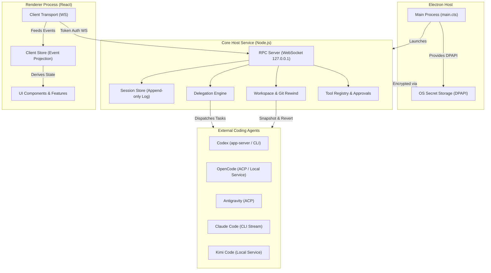
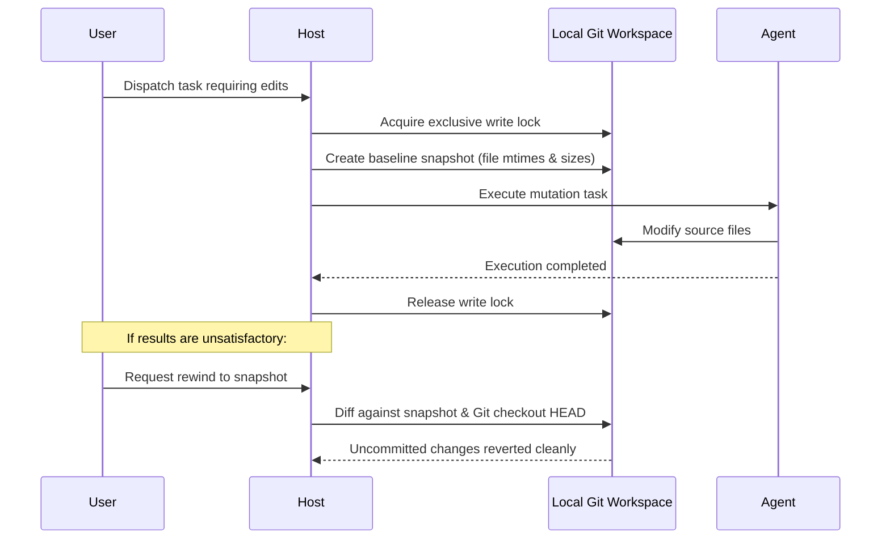

# SuperCoder Architecture & System Design

SuperCoder is a local Windows desktop orchestrator designed to dispatch, supervise, and coordinate multiple AI coding agents across user workspaces with full observability, concurrency control, and transactional rollback capabilities.

---

## 1. High-Level Architecture

The system is organized into four strictly isolated layers:



### Module Responsibilities

1. **Contracts (`src/shared/`)**:
   - Pure TypeScript definitions and Zod validation schemas.
   - Houses domain models, RPC method definitions, event structures, and error codes.
   - **Boundary Invariant**: Completely platform-agnostic with zero runtime dependencies on Node.js core modules or React.

2. **Host Engine (`src/host/`)**:
   - Manages the local Node.js service daemon.
   - Implements event-sourced append-only storage (`log.jsonl`) with resilient crash recovery.
   - Coordinates agent discovery, provider cascades, and execution pipelines.
   - Enforces workspace exclusive write locks and Git snapshots.

3. **Client Renderer (`src/client/`)**:
   - A modern React application styled with CSS Modules and customizable CSS custom properties.
   - State management is separated into a headless, framework-agnostic `ClientStore` that deterministically derives UI projections from incoming event streams.
   - Multi-language support (`en` and `zh-CN`) verified at build time.

4. **Desktop Shell (`electron/`)**:
   - Manages window lifecycle and native integrations.
   - Interacts with Windows DPAPI (`safeStorage`) for secure credential encryption without storing plain-text API keys.

---

## 2. Event-Sourced Storage Model

Every session is maintained as an append-only JSON Lines ledger:

```text
%APPDATA%/SuperCoder/sessions/<sessionId>/
├── log.jsonl        # The single source of truth (append-only events)
├── index.json       # Cached projection metadata (can be rebuilt anytime)
└── artifacts/       # Large file payloads and execution diffs
```

### Event Lifecycle

1. **Deterministic Appending**:
   Events are sequentially written with strictly monotonically increasing sequence IDs (`seq`).
2. **Crash Resilience**:
   If an unexpected process termination occurs during a write, the recovery logic truncates corrupted trailing bytes, validates line integrity, and appends a recovery event (`session/repaired`) without altering preceding history.
3. **Cache Invalidation**:
   `index.json` acts purely as a fast lookup cache. If missing or damaged, it is transparently reconstructed from `log.jsonl`.

---

## 3. Delegation & Multi-Agent Cascade

SuperCoder supports diverse agent runtimes through an extensible provider ladder:

| Agent | Integration Mechanism | Concurrency / Capabilities |
| :--- | :--- | :--- |
| **Codex** | app-server JSON-RPC / CLI fallback | Native streaming, tool approvals, read/write sandboxing |
| **OpenCode** | Agent Control Protocol (ACP) | Task dispatching, model inspection, execution monitoring |
| **Antigravity** | ACP protocol | Native model discovery, structured delegation |
| **Claude Code** | CLI streaming pipe | Read-only planning mode, interactive approval hooks |
| **Kimi Code** | Local HTTP service | Background worker lifecycle, automated local service startup |

### Task Dispatching & Safety

- **Task States**: `spawned` &rarr; `queued` &rarr; `submitted` &rarr; `received` &rarr; `returned` (or `failed` / `aborted`).
- **Uncertain Outcomes**: If a connection drops while a mutating task is in flight, the task transitions to an `unknown` state. The user must manually review and confirm side-effects before any subsequent retry.

---

## 4. Workspace Management & Transactional Rollback

To prevent data corruption when allowing AI agents to edit local codebases:



1. **Exclusive Write Locks**: Prevents concurrent write jobs from overlapping in the same directory.
2. **Fast Snapshots**: Records filesystem stat metadata (`mtime` + `size`) across thousands of files in sub-second timeframes.
3. **Git-Powered Rollback**: Instead of brittle custom diff engines, rewind operations leverage Git primitives to reliably restore modified files back to the exact pre-turn state.

---

## 5. Security & Isolation

- **Zero Remote Exposure**: The RPC WebSocket listens exclusively on loopback (`127.0.0.1`) and mandates a high-entropy 256-bit authentication token per session.
- **Credential Protection**: All LLM provider API keys are encrypted at rest using the operating system's native cryptographic subsystem (`DPAPI` via Electron `safeStorage`).
- **Command Sanitization**: Shell execution avoids shell wrappers (`shell: false`) and rejects shell metacharacters to eliminate command injection surfaces.
- **Dependency Hygiene**: Zero native C++ compilation dependencies in production runtime; all packages are pure JavaScript or WebAssembly.
